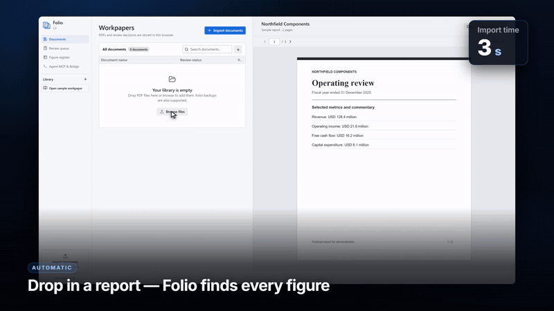

<h1 align="center">
  <br>
  Folio
</h1>

<p align="center">
  <b>Check every figure in a financial report against its source — automatically, in seconds.</b><br>
  A local workspace for reviewing figures from financial reports, statements and receipts, with an MCP server for AI agents and a REST API for your own apps.
</p>

<p align="center">
  <a href="https://github.com/dhia-eddine-mahdaoui/folio-review/releases/latest"></a>
  
  
  
</p>

<p align="center">
  <a href="docs/folio-demo.mp4"></a>
  <br>
  <a href="docs/folio-demo.mp4">▶ Watch the full demo video (1:52)</a>
</p>

## Why Folio

| | |
| --- | --- |
| ⚡ **Automatic** | Drop in a PDF. Folio reads the text layer, runs English OCR on scanned pages, and extracts every figure with its unit, period and scale. In the demo, a 48-page annual report gives 54 figures in under 4 seconds in the app, and in about 0.2 seconds through the REST API. |
| 🎯 **Accurate** | Statement cells carry their column period and stated scale, so `128.4` in a table marked *(In USD millions)* is stored as `128,400,000 USD`. Arithmetic is checked (net income, the balance sheet equation), and when the same metric disagrees across pages, Folio flags a **cross-page tie-out variance** and opens both pages side by side. |
| ⌨️ **Fast to review** | Highlights on the original page, one-key decisions (`Ctrl+Enter` approve and next, `H` hold, `Shift+E` escalate) and reason codes. The queue tracks Pending, On Hold, Escalated, Verified and Excluded. |
| 🔏 **Audit-ready** | Every decision is linked in a SHA-256 hash chain. **Sign & Seal** signs the chain with a hardware passkey (WebAuthn, ES256) and can encrypt the backup with AES-256-GCM. |
| 🤖 **Agent-ready** | A built-in MCP server lets Claude Code, Codex, Cursor or Gemini CLI run tie-outs, query the register and **propose** edits — drafts that wait for a person to approve them. |
| 🔌 **Easy to integrate** | One `POST` to `/api/v2/analyze` returns every finding as JSON, with the source page, text and box. |

> The demo uses *Northfield Components*, a fictional company. Timings were measured on a Windows laptop and will vary with your machine and documents.

## Contents

- [Install](#install)
- [Use it](#use-it)
- [Use it with AI agents (MCP)](#use-it-with-ai-agents-mcp)
- [Integrate it into your app (REST API)](#integrate-it-into-your-app-rest-api)
- [Extraction and review](#extraction-and-review)
- [Run from source](#run-from-source)
- [Tests](#tests)
- [Project layout](#project-layout)

## Install

Download Folio from the **[latest release](https://github.com/dhia-eddine-mahdaoui/folio-review/releases/latest)**:

| System | File |
| --- | --- |
| Windows 10 / 11 (x64) | `Folio-Review-x.y.z-x64-Setup.exe` — installs for the current user, with Start menu and optional desktop shortcuts |
| Linux x64 (glibc) | `Folio-Review-x.y.z-linux-x64.tar.gz` — extract it and run `Folio/install-linux.sh`, then open **Folio Review** from the application menu |

The release also includes an illustrated guide. The desktop launcher starts the local service and opens Folio in a standalone window when the default browser supports Chromium app mode; other browsers open it in a tab with the same profile and library.

To uninstall, use **Installed apps** on Windows or run the installed `uninstall.sh` on Linux. Folio keeps any agent skills you edited yourself.

## Use it

1. **Import** a PDF (up to 50 MB and 1,000 pages) or a `.folio` backup. Try **Open sample report** first: figures saved there stay inside the sample.
2. **Set the reviewer** in the workspace header. Saving without one opens an inline name prompt, so no decision is unattributed.
3. **Review** each finding: select a highlight to open it, hover over the source or citation to see the link, or **Select area** to draw around a region and capture its text. The heatmap separates clear evidence and verified figures from findings that need attention; colour is reserved for numbers that disagree.
4. **Check** the live normalized amount before saving, open a reconciliation banner to see the equation and its operands on the page, and open any **Cross-Page Tie-Out Variance** in split view.
5. **Export** the Figure register to CSV with source quotes and notes, or to **Formula Excel (.xlsx)**: a Reconciliation Summary sheet with live formulas (`=C4-SUM(C2:C3)` for arithmetic checks, `=C10-C11` for tie-outs), truncated SHA-256 audit hashes and `#page=N` source links, plus figures, findings, exception codes, assignments and activity history.
6. **Back up or seal** a workpaper as a `.folio` file. Restores verify the event chain, the manifest and every passkey signature.

<details>
<summary>More about review, storage and backups</summary>

- The Queue badge counts unresolved findings (Pending, On Hold and Escalated), and the Verify pane names the filter behind its item counter, for example `Item 2 of 8 · Unresolved filter`. Saving a figure also saves its assignee and priority.
- When the same canonical metric and fiscal period appear in more than one place — for example commentary on page 1 and the statement of operations on page 2 — Folio compares them. Narrative pages and statements share one US-GAAP / IFRS taxonomy, so `Revenue` in commentary maps to `Revenues (US-GAAP)` like the statement row. Different line items, such as operating income and income before taxes, are never tied out against each other.
- Activity history links every event to its predecessor and to the source PDF with SHA-256. Folio verifies the chain and manifest when restoring a version 2 or 3 `.folio` backup; legacy backups get a chain created at migration. Backups carry the reviewer profile, so a restore on another device fills it in.
- **Sign & Seal .folio** signs the current chain root with a hardware passkey (WebAuthn, ES256 / P-256), records a Sign-Off event and exports the archive. When the passkey supports the WebAuthn PRF extension, the archive is encrypted with AES-256-GCM under a key derived from the passkey, and restoring it needs the same passkey.
- PDFs, workpapers and the figure register are stored in SQLite-WASM inside a Web Worker using OPFS. Existing IndexedDB workpapers are migrated on first launch, and profiles without OPFS keep using IndexedDB. Export a `.folio` backup per document to move it between devices.
- Browsers keep storage per origin. On first launch, 3.0 offers **Move library**, which copies workpapers saved at `http://127.0.0.1:8031` by earlier versions, with their verified audit chains and preferences.
- The interface uses [Astryx](https://github.com/meta/astryx) for tables, cards and review controls.
</details>

## Use it with AI agents (MCP)

Folio runs a [Model Context Protocol](https://modelcontextprotocol.io) server at `http://127.0.0.1:8031/mcp` (Streamable HTTP, MCP 2026-07-28, with the legacy handshake still supported). Add it to Claude Code with:

```bash
claude mcp add --transport http folio http://127.0.0.1:8031/mcp
```

In Folio, open **Agent MCP & Bridge**, turn on **Share this workspace with local MCP clients**, and tick the tools the agent may use. Then ask, for example:

> *Use the folio MCP tools on the active workpaper. Run a tie-out, explain any reconciliation variance, and propose a finding edit that adds a reviewer note to the net income figure on page 2. Do not approve anything.*

In the demo, Claude Code runs `run_workpaper_tieout`, finds the 0.2 USD million gap between page 2 and the statements, and stages a note with `propose_finding_edit`. The draft appears in Folio above the read-only finding with its citation highlighted, and only a reviewer can approve it.

| Tool or resource | Access | What it does |
| --- | --- | --- |
| `analyze_pdf`, `analyze_text` | always on | Extract findings from a base64 PDF or from page text (optional `metric`, `page`, `offset` and `limit` filters). Only process the data in the request. |
| `query_figure_register` | read only | Search verified figures across documents. |
| `explain_reconciliation_variance` | read only | Explain reconciliation variances in the active workpaper. |
| `run_workpaper_tieout` | read only | Reconcile the active workpaper. With the `io.modelcontextprotocol/tasks` extension it returns a task handle at once; poll `tasks/get` and read `tasks/result`. |
| `propose_finding_edit` | draft | Stage an edit for reviewer approval. If the unit or period is ambiguous it returns `input_required`; repeat the call with `inputResponses` and the returned `requestState`. Links an MCP Apps card (`ui://folio/verification-card`) with the cropped evidence. |
| `review_finding_draft` | off by default | Lets the MCP Apps card's **Approve & Verify** button act, signed with your reviewer name. Activity history records card approvals as such. |
| `folio://workpapers/active/unresolved`, `folio://workpapers/active/variances`, `folio://register/verified` | read only | Unresolved findings, reconciliation variances and verified figures, through the live browser connection. |

`GET /api/v2` describes the wire format. The private hosted Site exposes the same `/mcp` route (analysis tools only) behind Sites authentication.

**Agent skills.** In Folio Desktop, **Agent MCP & Bridge** can preview, install or customize the `folio-review` skill for detected Codex, Claude Code, Gemini CLI and Cursor profiles. **Test connection** checks that Folio MCP responds and advertises its tools. Start a new agent session after installing or updating the skill. Installed agents can also use the bundled CLI to extract and OCR PDFs while the workbench is closed.

## Integrate it into your app (REST API)

POST a PDF and get every finding back as JSON:

```bash
curl --fail-with-body -H 'Content-Type: application/pdf' \
  --data-binary @report.pdf http://127.0.0.1:8031/api/v2/analyze
```

The same call from an existing Node app (this is the whole integration in the demo's sample *Closebook* app):

```js
async function extractFigures(pdf) {
  const res = await fetch('http://127.0.0.1:8031/api/v2/analyze', {
    method: 'POST', headers: {'Content-Type': 'application/pdf'}, body: pdf,
  })
  return res.json() // { pages, findings, arithmetic_checks, review_flags, receipt_check, needs_ocr, ... }
}
```

<details>
<summary>Example finding</summary>

```json
{
  "label": "Net income",
  "canonical_metric": "Net Income (US-GAAP)",
  "amount": "15.8",
  "unit": "USD million",
  "normalized_amount": "15800000",
  "period": "Twelve Months Ended December 31, 2025",
  "source": {
    "page": 16,
    "statement_heading": "Statements of Operations",
    "scale_note": "(In USD millions)",
    "column_heading": "Twelve Months Ended December 31, 2025",
    "box": [0.7189, 0.4593, 0.7516, 0.4716]
  }
}
```
</details>

- You can also POST JSON with a `pages` array of strings. Separate visual rows with newlines and keep page order.
- The response includes findings, source quotes, page numbers, proposed units and periods, `arithmetic_checks`, `receipt_check` and `needs_ocr`.
- Automation requests are limited to 8 MiB, 150 pages and 1.5 million extracted characters. The local service runs bundled English OCR on pages with fewer than 24 extracted characters. The hosted endpoint reads only the text layer and returns sparse pages in `needs_ocr`.
- The local server binds to loopback only. The original Python service is still available with `uvicorn folio.api:app` for existing `/api/extract` integrations.

## Extraction and review

The extractor recognizes explicit financial metrics and receipt summary lines, including growth narratives that report both a percentage and an ending amount. On English-language statements of operations, balance sheets and cash flows, Folio extracts labeled numeric cells, links date and duration headers, and applies the stated scale with share-count and EPS exceptions. Ambiguous column counts, missing context and failed arithmetic checks need review. Findings carry the reported value, normalized amount, and row and header evidence.

Extraction status describes the recognized observations; it does not certify that a document is complete. An empty unit or period means the extractor could not establish it, and a `$` symbol stays ambiguous unless the document gives a currency code. English OCR accuracy depends on image quality. Use Search for arbitrary fields, or select an area on the original.

<details>
<summary>OCR and layout engines</summary>

- **Default:** PDF text-layer geometry plus local English OCR, mapping recognized financial rows to a curated set of offline taxonomy tags. The browser runs OCR locally on sparse pages and can OCR any selected page, including pages of previously imported files. A page OCR retry replaces that page's search index and archives its old predictions; saved citations keep their original text.
- **Docling table layout:** install Docling into a Python environment and download its model artifacts, set `FOLIO_DOCLING_PYTHON` to that Python and `FOLIO_DOCLING_MODELS` to the artifact directory before starting the service, then enable **Use local Docling for table layout on import**. See the [Docling offline setup](https://docling-project.github.io/docling/faq/).
- **In-Browser Local VLM:** runs Florence-2 (`onnx-community/Florence-2-base-ft`) through Transformers.js in a Web Worker, on WebGPU when available and WASM/CPU otherwise. Choose it as the **Manual OCR engine** for page re-indexing and area selections. The model downloads once (about 250 MB) and page images stay on the device. Florence-2 returns text lines with boxes; it does not rebuild table grids.
- **Mistral OCR Hosted:** set `MISTRAL_API_KEY` in the local service environment and select it in settings. Folio sends the selected page or region as a PNG and uses the returned block geometry and word-confidence scores. See the [Mistral OCR documentation](https://docs.mistral.ai/studio/document-processing/basic_ocr).
- **Hosted HTTPS OCR provider:** configure it in **Agent MCP & Bridge** for manual retries. It receives a PNG of the page or region and returns JSON with a `lines` array of `text`, `box` (`[left, top, right, bottom]`, normalized 0–1) and optional `confidence` (0–100). It must allow the workbench origin via CORS.
</details>

## Run from source

Requirements: [Node.js 24 LTS](https://nodejs.org). Python 3 is only needed for the legacy FastAPI service and the desktop packaging scripts.

```bash
git clone https://github.com/dhia-eddine-mahdaoui/folio-review.git
cd folio-review
npm ci
npm run build
npm start
```

Open http://localhost:8031. Folio Desktop opens this address because passkeys need a domain origin.

<details>
<summary>Rebuild the desktop packages (Linux x64 host)</summary>

Run `npm ci && npm run build`. The staging script copies the pinned frontend and runtime dependencies into a new directory. Supply Node 24, its licence and the native Windows canvas package that matches the installed canvas version.

```bash
mkdir -p output/installers output/desktop-build
cd output/desktop-build
npm pack node-win-x64@24.18.0 @napi-rs/canvas-win32-x64-msvc@1.1.1
cd ../..
python3 desktop/stage.py windows output/desktop-build/windows \
  --node output/desktop-build/node-win-x64-24.18.0.tgz \
  --canvas output/desktop-build/napi-rs-canvas-win32-x64-msvc-1.1.1.tgz \
  --node-license /path/to/node-24.18.0/LICENSE
makensis -DPAYLOAD="$PWD/output/desktop-build/windows" -DVERSION=3.0.0 \
  -DOUTFILE="$PWD/output/installers/Folio-Review-3.0.0-x64-Setup.exe" desktop/installer.nsi
python3 desktop/stage.py linux output/desktop-build/Folio/app \
  --node /path/to/node-24.18.0/bin/node --node-license /path/to/node-24.18.0/LICENSE
cp desktop/*linux.sh output/desktop-build/Folio/
tar czf output/installers/Folio-Review-3.0.0-linux-x64.tar.gz -C output/desktop-build Folio
```
</details>

## Tests

```bash
npm run build
npx playwright install chromium   # or set FOLIO_TEST_CHROMIUM to an existing Chromium
npm test                          # unit, API and Chromium regressions
```

The browser tests start their own loopback server. Set `FOLIO_TEST_FIREFOX` to a Playwright Firefox executable to also verify cross-browser restoration. For the legacy FastAPI service, install `requirements.txt` in a Python environment and run `python -m unittest discover -s tests`.

## Project layout

| Path | What's there |
| --- | --- |
| `src/` | The React workbench: reader, review queue, figure register, statements, tie-outs, OCR, passkey sealing and storage workers |
| `server/` | Local HTTP service, REST API, MCP server, workspace bridge and extraction engines |
| `desktop/` | Desktop launcher, CLI, Windows installer, Linux scripts and the `folio-review` agent skill |
| `folio/` | Original Python extractor and FastAPI service |
| `public/` | Logo, font and the sample report |
| `tests/` | Unit, API and Playwright tests with PDF fixtures |
| `docs/` | Demo video and GIF |
